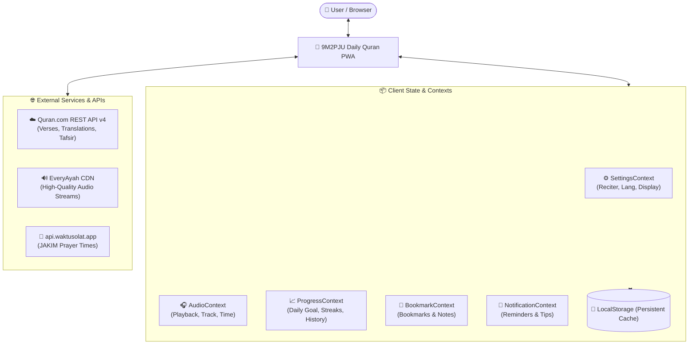

# 📖 9M2PJU Daily Quran

<p align="center">
  
</p>

<p align="center">
  <strong>A modern, luxury, and distraction-free Progressive Web App (PWA) for daily Quran reading, tadabbur reflections, audio murottal, and accurate Malaysian prayer times (JAKIM).</strong>
</p>

<p align="center">
  <a href="https://quran.hamradio.my"><strong>🌐 Live Web App: quran.hamradio.my</strong></a>
</p>

<p align="center">
  
  
  
  
  
  
  
</p>

---

## 🌟 Key Highlights

- 🌿 **Emerald & Warm Gold Aesthetic**: High-contrast, eye-friendly Midnight Emerald (`#07140e`) dark theme with Islamic geometry patterns and glowing warm gold accents.
- 📜 **Crystal-Clear Uthmani Arabic**: Rendered using standard Amiri and Noto Naskh Arabic typography with adjustable font scaling.
- 📚 **Full 114 Surahs & 30 Juz Navigator**: Search, filter by revelation place (Makkiyyah / Madaniyyah), or jump directly to any of the 30 Juz divisions.
- 🔍 **Scholarly Tafsir Drawer**: In-depth verse-by-verse commentary from Ibn Kathir, Al-Jalalayn, Ma'arif al-Qur'an, and Tazkirul Quran.
- 🎧 **High-Fidelity Audio Recitations**: Continuous or verse-by-verse playback by 10 world-renowned Qaris with synchronized verse highlighting and auto-scroll.
- 🕌 **JAKIM Prayer Times & Qibla Compass**: Automatic GPS-based Malaysian prayer zone detection ([waktusolat.app](https://waktusolat.app)) and mathematical Qibla bearing calculation.
- 🤖 **Next-Gen Search & Answer Engine Optimization (SEO / AEO)**:
  - Structured JSON-LD schemas (`WebSite`, `WebApplication`, `Organization`, `FAQPage`, `BreadcrumbList`).
  - Native machine-readable [`/llms.txt`](https://quran.hamradio.my/llms.txt) and [`/llms-full.txt`](https://quran.hamradio.my/llms-full.txt) contexts for AI engines (ChatGPT, Perplexity, Claude, Gemini).
  - Search engine friendly [`/robots.txt`](https://quran.hamradio.my/robots.txt) and automated 114-Surah [`/sitemap.xml`](https://quran.hamradio.my/sitemap.xml).
- 📲 **Installable Progressive Web App**: Fully offline-capable with Workbox service workers, install prompt, and native mobile feel.

---

## 📑 Feature Tour

### 📖 1. Al-Quran Reading & Study
* **Uthmani Script**: Precision Arabic text with authentic vocalization marks and verse end ornaments.
* **Multi-Language Translations**: Standard Malay (*Abdul Hameed & Abdullah Basmeih*), English (*Saheeh International*), Indonesian, and 24+ additional languages.
* **Tafsir Exegesis Drawer**: Instant drawer for reviewing authentic classical interpretations alongside each Ayah.
* **Focus & Reading Mode**: Distraction-free full-screen reader with keyboard shortcuts (`Space` to toggle audio, `J`/`K` to navigate verses).
* **Font Customization**: Real-time scalable font controls (`A-` / `A+`) persisting across browsing sessions.

### 🎧 2. Audio Murottal Engine
* **10 World-Renowned Qaris**:
  - *Mishary Rashid Alafasy*
  - *Abdul Basit Murattal*
  - *Abdur-Rahman as-Sudais*
  - *Saad Al-Ghamdi*
  - *Abu Bakr Ash-Shatri*
  - *Hani Ar-Rifai*
  - *Mahmoud Khalil Al-Husary*
  - *Mohamed Siddiq El-Minshawi*
  - *Ahmed ibn Ali Al-Ajamy*
  - *Maher Al-Muaiqly*
* **Sticky Header & Mobile Floating Player**: Seamless audio controls across the entire application.
* **Screen Wake Lock**: Keeps device screens active during long recitation sessions without sudden sleep timeouts.

### 🕌 3. Waktu Solat & Kompas Kiblat (JAKIM Malaysia)
* **Zon Solat JAKIM Automatik**: Auto-detects GPS coordinates to assign appropriate official Malaysian prayer zones (e.g., *SGR01, WLY01, JHR02*).
* **Jadual Waktu Solat Harian**: Subuh, Syuruk, Zohor, Asar, Maghrib, dan Isyak dengan penunjuk waktu solat seterusnya (*Next Prayer*).
* **Kompas Arah Kiblat Interaktif**: Pengiraan sudut bearing Kaabah dengan format darjah, DMS (*Degree, Minute, Second*), dan jarak kilometer ke Makkah Al-Mukarramah.

### 🔖 4. Penanda Buku, Nota Tadabbur & Rekod Istiqamah
* **Bookmark Ayah**: Tandakan ayat dengan satu sentuhan.
* **Nota Tadabbur Peribadi**: Tulis dan simpan refleksi peribadi pada mana-mana ayat Al-Quran.
* **Streak Istiqamah 7 Hari**: Pantau kekerapan bacaan harian dan capai sasaran tilawah harian anda.
* **Pustaka & Koleksi Pilihan**: Akses pantas surah pilihan (*Amalan Pagi & Petang, Sunnah Jumaat, Ruqyah & Perlindungan, 10 Surah Terakhir*).

---

## 🏗️ Architecture & Data Flow



---

## 📂 Project Directory Structure

```text
9M2PJU-Daily-Quran/
├── public/
│   ├── favicon.ico
│   ├── icon-192.png
│   ├── icon-512.png
│   ├── llms.txt               # AI & LLM Search Engine Guide
│   ├── llms-full.txt          # Complete LLM Corpus & Context
│   ├── robots.txt             # Search & AI Bot Crawl Policies
│   └── sitemap.xml            # Canonical URL Sitemap for all 114 Surahs
├── src/
│   ├── components/
│   │   ├── Layout.tsx         # Sidebar, Header, Mobile Nav & Audio Player
│   │   └── SurahCard.tsx      # Surah Grid Tile Component
│   ├── contexts/
│   │   ├── AudioContext.tsx   # Global Murottal Player State
│   │   ├── BookmarkContext.tsx# Bookmarks & Reflection Notes
│   │   ├── NotificationContext.tsx # Notifications & Tips
│   │   ├── ProgressContext.tsx# Streaks, Goals & Reading History
│   │   └── SettingsContext.tsx# Reciters, Translations & Theme
│   ├── hooks/
│   │   ├── useGeolocation.ts  # GPS Coordinate Tracker
│   │   ├── usePageSEO.ts      # Dynamic Title, Meta & Canonical Hook
│   │   └── usePrayerTimesCache.ts # Cached JAKIM Prayer Times
│   ├── pages/
│   │   ├── Activity.tsx       # Consistency Chart & Stats
│   │   ├── Bookmarks.tsx      # Saved Verses & Tadabbur Notes
│   │   ├── Home.tsx           # Dashboard, Verse of the Day, Quick Access
│   │   ├── Library.tsx        # Curated Surah Collections
│   │   ├── Notifications.tsx  # Daily Reminders & Quran Insights
│   │   ├── PrayerTimes.tsx    # JAKIM Prayer Table & Qibla Compass
│   │   ├── Settings.tsx       # Preferences & PWA Install Button
│   │   ├── Surah.tsx          # Full Uthmani Reader & Tafsir Drawer
│   │   └── SurahList.tsx      # 114 Surahs & 30 Juz Directory
│   ├── services/
│   │   └── api.ts             # Quran.com & Tafsir API Service
│   ├── index.css              # Custom Tailwind Tokens & Islamic Themes
│   └── main.tsx               # Application Entry Point
├── package.json
├── tailwind.config.js
├── tsconfig.json
└── vite.config.ts
```

---

## 🛠️ Tech Stack & Ecosystem

| Layer | Tooling | Purpose |
|---|---|---|
| **Core Framework** | [React 19](https://react.dev/) + [TypeScript 5.9](https://www.typescriptlang.org/) | Modern UI component model & strict type safety |
| **Bundler** | [Vite 7](https://vitejs.dev/) | Ultra-fast HMR and optimized production bundling |
| **Styling** | [Tailwind CSS 4](https://tailwindcss.com/) | Theme tokens, custom gradients, and glassmorphic UI |
| **Routing** | [React Router 7](https://reactrouter.com/) | Hash-based SPA routing with lazy chunk loading |
| **Animation** | [Framer Motion](https://www.framer.com/motion/) | Smooth layout transitions & micro-interactions |
| **Typography** | Amiri, Noto Naskh Arabic | Typographically correct Quranic glyphs & vocalization |
| **PWA** | `vite-plugin-pwa` + Workbox | Offline caching, background sync & install banner |
| **Data APIs** | Quran.com API, EveryAyah, WaktuSolat.app | Reliable open APIs for text, audio, and prayer times |

---

## 🚀 Getting Started

### Prerequisites
- Node.js (v18.x or higher)
- npm / pnpm / yarn

### Installation & Development

```bash
# 1. Clone the repository
git clone https://github.com/9M2PJU/9M2PJU-Daily-Quran.git
cd 9M2PJU-Daily-Quran

# 2. Install dependencies
npm install

# 3. Start local development server
npm run dev

# 4. Open browser at http://localhost:5173
```

### Production Build & Preview

```bash
# Typecheck & build production bundle
npm run build

# Preview production build locally
npm run preview
```

---

## 🌐 Custom Domain & Deployment

This project is deployed to GitHub Pages and served under a custom domain:
- **Canonical URL**: `https://quran.hamradio.my`
- **DNS / CDN**: Managed via Cloudflare with automatic SSL/TLS, edge caching, and HTTP/3 support.

---

## 📋 Changelog

Refer to [CHANGELOG.md](CHANGELOG.md) for full version history and release notes.

---

## 📄 License

Distributed under the [GNU Affero General Public License v3.0 (AGPLv3)](LICENSE).

---

## ☕ Support

If you find this project beneficial for your daily tilawah and spiritual growth, you can support its maintenance and ongoing development:

[](https://buymeacoffee.com/9m2pju)

<p align="center">
  Crafted with care by <a href="https://github.com/9M2PJU"><strong>9M2PJU</strong></a><br/>
  <em>"Guide us to the straight path." — Surah Al-Fatihah 1:6</em>
</p>


## Support

If you find this project useful, please consider supporting it:

[](https://paypal.me/9M2PJU)
